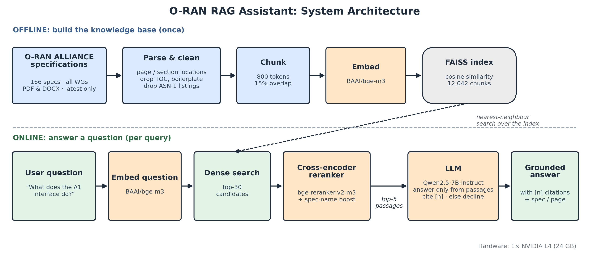

# O-RAN RAG Assistant

**Website:** https://timalsinaditya.github.io/oran-rag-lab/ (architecture, results, a browser for all 1,500 benchmark questions, and the list of specifications)

A retrieval-augmented generation (RAG) assistant for the O-RAN ALLIANCE specifications, built for Lab 2 (ECE 592 / CSC 591). It answers questions about O-RAN using only passages retrieved from 166 specifications, cites every claim as `[n]` with spec name and page/section, and declines when the documents do not cover the question.

**Headline result:** on the official ORANBench evaluation set from ORANSight-2.0 (1,500 multiple-choice questions sampled from ORAN-Bench-13K), **Qwen2.5-7B-Instruct + RAG scores 0.879**, versus 0.721 for the same model without RAG. That is on par with ORANSight-2.0's best published system (0.889, a 32B fine-tuned model with RAG) and above it on the hard split (0.896 vs 0.878).



## Pipeline

| Stage | Choice |
|---|---|
| Corpus | 166 O-RAN specs (167 files, PDF + DOCX, latest version only, all working groups) |
| Parsing | page (PDF) / section (DOCX) locations; table of contents, boilerplate and ASN.1 listings removed |
| Chunking | 800 tokens, 120-token (15%) overlap → 12,042 chunks |
| Embedding | `BAAI/bge-m3`, FAISS `IndexFlatIP` (cosine) |
| Retrieval | dense top-30 → cross-encoder `BAAI/bge-reranker-v2-m3` (+0.2 spec-name boost) → top-5 |
| Generator | `Qwen/Qwen2.5-7B-Instruct` (bf16) |
| Judge (Task A) | `microsoft/phi-4` (4-bit) |
| Hardware | 1× NVIDIA L4 (24 GB) |

## Results

| Evaluation | No RAG | RAG |
|---|---|---|
| ORANBench official set (1,500 MCQ) | 0.721 | **0.879** |
| Task A — 8 docs, 50 questions (Phi-4 judge) | 26% | 96% |
| Task A — 29 docs, original questions | 28% | 96% |
| Task A — 29 docs, diverse questions | 18% | 90% |

RAG fixed 320 answers and broke 82. The gain is largest when the reranker is confident about the top passage (see `report/fig2_rag_effect.png`). The full write-up is in [`report/REPORT.md`](report/REPORT.md) (also `REPORT.docx` / `REPORT.html`).

## Repository layout

```
app.py              Gradio web app: Chat (cited, streaming), ORAN-Bench quiz, Explorer, Results, About
rag.py              retrieval (dense + rerank, optional BM25 hybrid) and generation
ingest.py           parse → clean → chunk → embed → FAISS index
eval.py, eval/      Task A: 50-question base vs RAG evaluation with an LLM judge
demo_b1.py          Task B1: spec Q&A with citations
download_specs.sh   download all 180 O-RAN spec files (resumable)
getspec.sh          download individual specs by O-RAN download id
bench/run_bench.py  ORAN-Bench-13K / ORANBench: sample → retrieve → answer → score
bench/analysis.py   fixed/broke, confidence quartiles, position bias, error analysis
bench/sets, runs    question sets and per-question predictions
results/            Task A outputs and analysis
report/             report (MD/DOCX/HTML), figures and their scripts
site/               static website (GitHub Pages), built by site/build_data.py
catalog/            spec catalogue and download IDs
```

## Running it

```bash
python -m venv .venv && .venv/bin/pip install -r requirements.txt

# 1. Get the specs (not included: the O-RAN ALLIANCE licence forbids redistribution).
#    Downloads all 180 files listed in catalog/user_ids.txt into docs_full/; re-run to resume.
./download_specs.sh

# 2. Build the index (~12k chunks)
DOCS_DIR=docs_full INDEX_DIR=index_full .venv/bin/python ingest.py

# 3. Web app on port 7860
.venv/bin/python app.py
#    from your laptop: ssh -N -L 7860:localhost:7860 <user>@<server>  → http://localhost:7860

# 4. Benchmark (official ORANBench set)
.venv/bin/python bench/run_bench.py retrieve --set oranbench --index index_full --tag idxfull -k 10
.venv/bin/python bench/run_bench.py answer   --set oranbench --ctx idxfull -k 5 --tag q7b_ragfull
.venv/bin/python bench/run_bench.py answer   --set oranbench --tag q7b_base
.venv/bin/python bench/run_bench.py score
```

Multiple-choice questions are scored from the model's next-token logits over the option digits (no free-text parsing). The benchmark papers (ORAN-Bench-13K, ORANSight) are excluded from the corpus, and benchmark questions are never indexed.

## Not in this repository

The specification files (`docs*/`), FAISS indexes (`index*/`), cached retrieval contexts (`bench/ctx/`), the passage text inside `results/*/eval_answers.json` (only source and page are kept) and the virtual environment are excluded — the specs for licensing reasons, the rest because they can be regenerated with the commands above.

## References

- ORAN-Bench-13K: P. Gajjar, V. K. Shah, arXiv:2407.06245
- ORANSight-2.0: P. Gajjar, V. K. Shah, arXiv:2503.05200 (IEEE TMLCN 2025); dataset `prnshv/ORANBench`
- BGE-M3 and bge-reranker-v2-m3 (BAAI), Qwen2.5 (Alibaba), Phi-4 (Microsoft), FAISS (arXiv:1702.08734)
