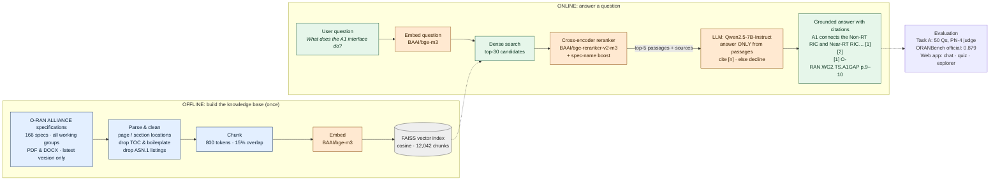

# Architecture diagram: prompt for ChatGPT

Copy everything below the line into ChatGPT. Ask for the image first; if the text in the image comes out garbled (image models often misspell small labels), ask it for **draw.io XML** or **Mermaid** instead, using the same description. The Mermaid version is at the bottom if you want to render it yourself (e.g. mermaid.live).

---

Create a clean, professional system-architecture diagram for an academic paper (IEEE style), landscape orientation, white background, flat design, no 3D, no clip-art people. Use a restrained palette: dark navy for text and arrows, light blue fill for "offline / indexing" boxes, light green fill for "online / question answering" boxes, light orange fill for model boxes, and a light grey fill for data stores (drawn as cylinders). Every label must be spelled exactly as written below. Use a sans-serif font, and keep all text horizontal and readable.

Title at the top: **"O-RAN RAG Assistant: System Architecture"**

The diagram has two horizontal lanes, separated by a thin dashed line and labelled on the left side:

**Top lane, labelled "OFFLINE: build the knowledge base (once)"**, flowing left to right:

1. A stack-of-documents icon labelled **"O-RAN ALLIANCE specifications"** with a smaller sub-label **"166 specs · all working groups · PDF & DOCX · latest version only"**.
2. Arrow to a box **"Parse & clean"** with three small bullet lines inside:
   - "page (PDF) / section (DOCX) locations"
   - "drop table of contents & boilerplate"
   - "drop ASN.1 code listings"
3. Arrow to a box **"Chunk"** with bullets:
   - "800 tokens"
   - "15% overlap"
4. Arrow to an orange model box **"Embed: BAAI/bge-m3"**.
5. Arrow to a grey cylinder **"FAISS vector index (cosine) · 12,042 chunks"**.

**Bottom lane, labelled "ONLINE: answer a question (per query)"**, flowing left to right:

1. A user/chat icon labelled **"User question"** with an example in small italic text: *"What does the A1 interface do?"*
2. Arrow to an orange model box **"Embed question: BAAI/bge-m3"**.
3. Arrow to a box **"Dense search: top-30 candidates"**, with a thin dotted arrow coming down into it from the FAISS cylinder in the top lane.
4. Arrow to an orange model box **"Cross-encoder reranker: BAAI/bge-reranker-v2-m3"** with a small sub-label **"reads question + passage together · + spec-name boost"**.
5. Arrow labelled **"top-5 passages + sources"** to an orange model box **"LLM: Qwen2.5-7B-Instruct"** with a sub-label **"answer ONLY from passages · cite [n] · else: 'The provided documents do not cover this.'"**.
6. Arrow to an output box **"Grounded answer with citations"** containing a small mock answer:
   "A1 connects the Non-RT RIC (SMO) and the Near-RT RIC: policies, feedback, enrichment info [1][2]"
   and below it two tiny source tags: "[1] O-RAN.WG2.TS.A1GAP p.9–10" and "[2] O-RAN.WG2.TS.A1GAP p.10–11".

**Small side panel on the right**, a rounded rectangle labelled **"Evaluation"**, with three short lines:
- "Task A: 50 questions, base vs RAG, judged by Phi-4"
- "ORAN-Bench-13K (official ORANBench set): 0.879"
- "Web app: chat · quiz · explorer · results"

A thin grey arrow goes from the "Grounded answer" box to this panel.

**Footer, small grey text, bottom right:** "Hardware: 1× NVIDIA L4 (24 GB)"

Keep generous spacing, align boxes on a grid, use straight or orthogonal arrows (no curvy spaghetti), and make sure no labels overlap.

---

## Mermaid version (render at mermaid.live or in any Markdown editor that supports Mermaid)

