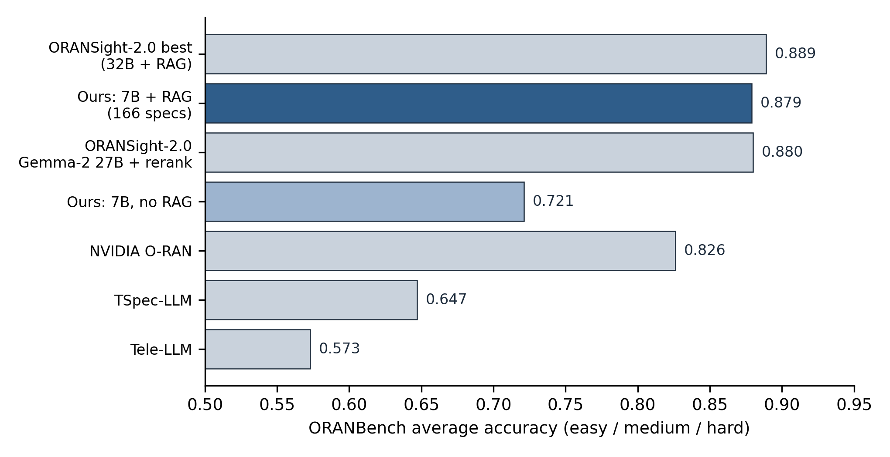
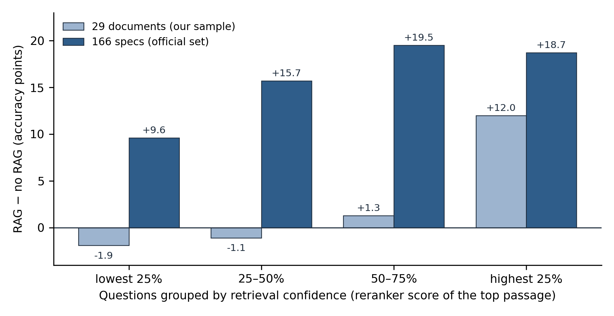

# A Retrieval-Augmented O-RAN Assistant: Grounded Answers from the O-RAN Specifications with a 7B Model

**[Your name]** · ECE 592 / CSC 591, AI-native Telecom Networks · Lab 2 · November 2026

---

## Abstract

General-purpose LLMs know surprisingly little about O-RAN. When we asked Qwen2.5-7B-Instruct what the A1 interface does, it said A1 connects the Radio Unit and the Distributed Unit, which is wrong. In this lab we built an assistant that answers O-RAN questions from the specifications themselves. It splits the O-RAN ALLIANCE specs into chunks, finds the relevant ones with dense retrieval followed by a cross-encoder reranker, and has the 7B model answer only from those passages, citing each one. On our own 50 test questions the assistant was right 90–96% of the time, against 18–28% for the same model without retrieval. We also evaluated on ORAN-Bench-13K, a public benchmark with thousands of O-RAN multiple-choice questions. On ORANBench, the exact 1,500-question set the ORANSight-2.0 authors published, our system scores **0.879**. That beats the NVIDIA O-RAN chatbot (0.826) and is within one point of ORANSight-2.0's best result (0.889), which uses a fine-tuned 32B model. On the hardest questions we score higher than ORANSight-2.0 (0.896 vs 0.878). The biggest single factor was the corpus: going from 29 documents to the full set of 166 specifications raised accuracy by about 13 points. We also show when retrieval hurts, namely when it returns passages that don't contain the answer, and we built a web app for chatting with the assistant and exploring the results.

---

## 1. Introduction

O-RAN is specified in well over a hundred documents spread across eleven working groups, each with its own release cycle. Engineers who need one detail, like which messages an E2 node exchanges with the Near-RT RIC or what timing window a C-Plane message must arrive in, have to know which document to open and then find the right clause. An LLM assistant could help, but only if its answers can be trusted. Out of the box they can't. Ask a general model about O-RAN and it fills the gaps with plausible-sounding 3GPP or vendor terminology. In our tests the base model invented an interface ("N24"), a working group ("Z-WG, Zonal Working Group") and a capacity figure ("10 to 50 Near-RT RICs per E2 node") without any hint of doubt.

Retrieval-augmented generation (RAG) [1] addresses this by giving the model the relevant text at question time and asking it to answer from that text only. The answer can then be checked, because every claim points to a passage in a specific spec.

This report covers what we built and what we found:

1. **A RAG pipeline for O-RAN specifications** (Part 1): parsing PDF and DOCX specs with page and section locations, cleaning out noise that hurts retrieval, two-stage retrieval (dense search, then a cross-encoder reranker), and a 7B generator that cites its sources and declines when the documents don't cover a question.
2. **An evaluation against the plain model** (Part 2, Task A): 50 hand-written questions with reference answers, judged by an LLM from a different model family, with manual review of the judge.
3. **A spec Q&A assistant with citations** (Part 2, Task B1), demonstrated on five queries, including one about an interface that doesn't exist.
4. **A benchmark comparison with published systems** on ORAN-Bench-13K [2], using the exact question set from ORANSight-2.0 [3], plus an analysis of when retrieval helps and when it hurts.
5. **A web application** for chatting with the assistant, quizzing it on benchmark questions, and browsing every evaluated answer.

---

## 2. Related work

**Retrieval-augmented generation.** Lewis et al. [1] combined a dense retriever with a generator so that a model can use knowledge it was never trained on. Most practical systems now retrieve in two stages: a bi-encoder (here BGE-M3 [4]) quickly finds candidate passages, then a cross-encoder reranker [5] reads the question and each candidate together and re-scores them. Retrieval has failure modes too: irrelevant context can distract a model into a wrong answer [6].

**LLMs for telecom and O-RAN.** Several domain-specific efforts exist. Tele-LLMs [7] continue pre-training general models on telecom text; TSpec-LLM [8] provides a dataset of 3GPP specifications; NVIDIA described an advanced RAG pipeline for O-RAN specifications [9]. ORAN-Bench-13K [2] is the standard O-RAN benchmark: about 13,900 multiple-choice questions generated from O-RAN specifications at three difficulty levels. ORANSight-2.0 [3] fine-tunes 18 open models on O-RAN data and evaluates them on ORANBench, a 1,500-question subset (500 per level). Its best configuration, a fine-tuned Qwen2.5-32B with RAG, reaches 0.889.

**LLM-as-a-judge.** For free-text answers we use an LLM judge, which has been shown to agree well with human graders [10]. Because judges tend to prefer their own model family's outputs [11], our judge (Phi-4 [12]) comes from a different family than our generator (Qwen2.5 [13]).

---

## 3. System design

**Figure 1.** System architecture. Offline, the 166 specifications are parsed, cleaned, chunked and embedded into a FAISS index. Online, a question is embedded, the 30 nearest chunks are reranked by a cross-encoder, and the top 5 are given to Qwen2.5-7B, which answers only from them and cites each passage.

The system has an offline part (building the knowledge base) and an online part (answering a question). Everything runs on a single NVIDIA L4 GPU with 24 GB of memory.

### 3.1 Corpus

We started with 8 documents for the first prototype (the O-RAN architecture description, the AI/ML workflow report, A1 and E2 general aspects, E2AP, the Near-RT RIC architecture, and the two benchmark papers) and grew it to 29 documents for the lab evaluation, covering all eleven working groups.

For the benchmark we needed the full specification set. The O-RAN ALLIANCE portal serves each file by a numeric ID. We catalogued the IDs, grouped files that are versions of the same spec, and kept only the newest release of each. This avoids two versions of the same text competing for the top results. The final corpus has **167 PDF and DOCX files covering 166 specifications** from all eleven working groups plus the Test and Integration, Sustainability and Security focus groups (about 430 MB). We deliberately left out the ORAN-Bench-13K and ORANSight-2.0 papers so the benchmark couldn't leak into retrieval.

### 3.2 Parsing and cleaning

PDFs are read page by page and every chunk keeps its page range ("p.8–9"). Word files are read paragraph by paragraph and table by table, and every chunk keeps the section heading it belongs to ("§5.1 E2AP procedure modules"), since Word files have no fixed pages. These locations become the citations.

Much of a spec is text that matches many questions without answering any. In the first prototype, "List the E2AP services" retrieved table-of-contents lines and revision-history tables instead of the clause that lists the services. We therefore remove:

- table-of-contents lines (dot leaders) and TOC-styled paragraphs,
- boilerplate sections (front matter, references, revision history, notation),
- ASN.1 code listings, which are long, repetitive and match almost any protocol question.

### 3.3 Chunking

Chunks are measured in tokens and overlap so that a sentence cut at a boundary still appears whole in one chunk. We use **800-token chunks with 120 tokens of overlap (15%)**, within the 500–1000 / 10–20% range the lab asked for. That size usually holds a complete clause or table with its explanation. The 8-document prototype has 385 chunks, the 29-document lab corpus 2,461, and the full 166-specification corpus **12,042**.

### 3.4 Retrieval

1. **Dense search.** Chunks and the question are embedded with BAAI/bge-m3 [4] (1,024 dimensions, 8k-token input, so chunks are never cut off). We search an exact FAISS inner-product index over normalized vectors [14], which is cosine similarity, and keep the 30 closest chunks. At this corpus size exact search takes milliseconds, so there's no need for approximate search.
2. **Reranking.** A cross-encoder, BAAI/bge-reranker-v2-m3, reads the question together with each of the 30 candidates and scores how well the passage answers it. The top *k* (default 5) are kept. This is the slowest step, about 2.6 seconds per question, and the most valuable one: the embedding model only knows a passage is *about* the right topic, while the reranker judges whether it *answers* the question.
3. **Spec-name boost.** If the question names a spec ("in E2AP", "the A1 interface"), chunks from that spec get +0.2 on their reranker score. Matching uses the full spec name so that ordinary words never trigger it.

We also tried query expansion, where the model rewrites the question before searching. We dropped it: on "List the E2AP services" it invented a term ("BBU Benchmarking") and retrieved worse passages.

### 3.5 Generation

The generator is **Qwen2.5-7B-Instruct** [13] in bf16, which fits on the GPU next to the retriever and reranker. It is the same model family as ORANSight-2.0's best system, which makes the comparison fairer. The prompt numbers the passages and instructs the model to

- use only the passages, not outside knowledge,
- cite every claim with the passage number, e.g. [1] or [2][3],
- reply "The provided documents do not cover this." when the passages don't contain the answer.

The no-RAG baseline uses the same model with a short "you are an O-RAN expert, answer concisely" prompt and no passages.

### 3.6 Web application

> **[SCREENSHOT 1: Chat tab. Ask "What does the A1 interface do?" with "Also show the answer without RAG" ticked. Capture the cited answer, the passage panel on the right, and the wrong baseline answer underneath.]**

The Gradio app has five tabs:

- **Chat:** streaming answers with citations and a panel showing the cited passages (spec, page or section, relevance score, full text on click). Follow-up questions work: "What are its main services?" is searched together with the earlier question that named the topic. Settings let the user switch between the full and the lab knowledge base, change *k*, and show the no-RAG answer side by side.
- **ORAN-Bench quiz:** draws a random benchmark question and lets the model answer it live, with or without retrieval, showing its confidence in each option.
- **Explorer:** every saved benchmark answer, filterable by level and by outcome (for example "RAG fixed it" or "RAG broke it"), with the passages retrieval returned.
- **Results:** all result tables.
- **About:** the pipeline and design choices.

---

## 4. Experimental setup

### 4.1 Task A: our own questions

We wrote two sets of 25 questions, each with a reference answer and the spec and location where the answer is found.

- **Original set:** concentrated on A1, E2, E2AP, the Near-RT RIC, the overall architecture and AI/ML.
- **Diverse set:** covers WG1–WG11 and seven question types: definition, list, numeric, comparison, multi-hop, procedure, and two *unanswerable* questions. One asks about a "Z7 interface" that doesn't exist; the other asks for a maximum number of xApps that the spec never defines.

Each question is answered by the plain model and by the RAG system. A judge, Microsoft Phi-4 (4-bit), grades correctness against the reference (correct / partial / incorrect) and grounding, meaning whether the answer is supported by the cited passages (yes / partial / no). On unanswerable questions, a refusal counts as correct. We read every verdict and overrode the judge only where it was clearly wrong, logging the reason; the report shows accuracy both before and after review. **Accuracy** counts a correct answer as 1 and a partial answer as 0.5. We also report retrieval **hit@5**: whether the spec holding the answer is among the five retrieved passages.

### 4.2 ORAN-Bench-13K

The benchmark is multiple choice, so we score it without parsing free text. The model sees the question and its options (plus the passages, for RAG) and we read its next-token probabilities for the option numbers "1", "2", "3", "4". The highest one is its answer. This is deterministic, needs one forward pass, and can't fail on formatting. For retrieval, the search query is the question together with its options, because the options often contain the terms that tell the right passage apart from the others.

We report results on two question sets:

- **ORANBench, the official set:** the exact 1,500 questions (500 per level) that ORANSight-2.0 used. Its authors published them on Hugging Face. 1,497 of them match the current GitHub benchmark word for word with the same answer; we use the published text for the other 3. **This is the set we compare against published numbers.**
- **Our own random sample** of 500 per level (seed 42). It shares only 105 questions with the official set, so it acts as an independent second check.

**Fairness rules.** The two benchmark papers are excluded from retrieval. None of the benchmark questions appears verbatim in the indexed corpus. The specs contain the *facts* the questions were written from, which is what RAG is supposed to use, and it's the same setup ORANSight-2.0 used. We always report the model without retrieval alongside.

---

## 5. Results

### 5.1 Part 1: first smoke tests

The first prototype (8 documents, 385 chunks) already showed the difference retrieval makes.

| Question | Without RAG | With RAG |
|---|---|---|
| What does the A1 interface do? | "A1 is used for communication between the Radio Unit (RU) and the Distributed Unit (DU)." Wrong: that's the fronthaul. | Interface between the Non-RT RIC in the SMO and the Near-RT RIC: policies for UEs and cells, policy status and feedback, enrichment information, AI/ML model exchange [A1GAP p.9–11] |
| List the E2AP services. | "E2AP defines several services for communication between gNodeBs and the E2 node: E2 Setup, E2 Modification, E2 Release, E2 Status Reporting, E2 Notification." Invented: E2AP runs between the E2 node and the Near-RT RIC, and these aren't its services | After adding the reranker, noise filtering and the spec-name boost: the RIC services and procedures from E2AP §8.1 |

> **[SCREENSHOT 2 (optional): the terminal output of `python rag.py "What does the A1 interface do?"`, showing the top-5 passages with sources, the RAG answer and the baseline. This is the Part 1 CLI deliverable.]**

"List the E2AP services" was the question that shaped the pipeline. The first version answered from table-of-contents lines. Adding the E2 general aspects document, removing TOC lines, adding the reranker, filtering boilerplate and ASN.1, and boosting chunks from the named spec fixed it step by step.

### 5.2 Task A: base model vs RAG

**Table 1. Task A results (25 questions each, judged by Phi-4, after manual review).**

| Metric | Original Qs, 8 docs: Base | RAG | Original Qs, 29 docs: Base | RAG | Diverse Qs, 29 docs: Base | RAG |
|---|---|---|---|---|---|---|
| Accuracy (correct + ½ partial) | 26% | **96%** | 28% | **96%** | 18% | **90%** |
| Accuracy, judge only | 28% | 94% | 28% | 96% | 18% | 88% |
| Strict accuracy (fully correct only) | 4% | 92% | 8% | 92% | 4% | 80% |
| Grounding | n/a | 98% | n/a | 94% | n/a | 88% |
| Answers with citations | 0% | 100% | 0% | 100% | 0% | 92% |
| Retrieval hit@5 | n/a | 96% | n/a | 88% | n/a | 91% |

Retrieval raises accuracy from around 20–30% to 90–96%. Growing the corpus from 8 to 29 documents didn't hurt the original questions (96% both times), even though the retriever had more than six times as many chunks to search. The diverse set is harder, mainly because it covers working groups where questions are more specific. Manual review changed three verdicts in total, all with logged reasons. In one case the judge marked RAG "partial" because our own reference list was incomplete: the RAG answer listed more SMO services than we had written down, all of them genuinely in SMO-ARCH §4.2.1.

**Table 2. Diverse set by question type (accuracy).**

| Type | N | Base | RAG |
|---|---|---|---|
| List | 6 | 25% | 100% |
| Definition | 9 | 6% | 83% |
| Numeric | 4 | 12% | 88% |
| Comparison | 2 | 50% | 75% |
| Multi-hop | 1 | 0% | 100% |
| Procedure | 1 | 0% | 100% |
| Unanswerable | 2 | 50% | 100% |

**Where the base model hallucinated and RAG was right.** This happened in 12 of 25 original questions and 15 of 25 diverse questions. Four examples:

1. **"How many Near-RT RICs can a single E2 Node be connected to?"**
   - *Base:* "...typically in the range of 10 to 50 or more."
   - *RAG:* "A Near-RT RIC can be connected to multiple E2 Nodes, but a single E2 Node is connected to only one Near-RT RIC [1]."
   - *Cited passage [1]* (O-RAN.WG3.TS.E2GAP-R005-v09.00, p.8–9): "E2 is a logical interface connecting the Near-RT RIC with an E2 Node … The Near-RT RIC is connected to the O-CU…"
2. **"Into which two modules are E2AP procedures divided?"**
   - *Base:* "E2 Setup and E2 Control."
   - *RAG:* "1. RIC Functional Procedures; 2. Global Procedures [2][5]."
   - *Cited passage* (O-RAN.WG3.TS.E2AP-R005-v09.00, §5.1 "E2AP procedure modules").
3. **"What is the R1 interface and what does it enable?"**
   - *Base:* "the Radio Unit (RU) to Remote Radio Unit (RRU) or Distributed Antenna System interface."
   - *RAG:* the interface between rApps and the Non-RT RIC framework, enabling service registration and discovery, authentication and authorization of rApps, and data management and exposure [1][4][5].
   - *Cited passage* (O-RAN.WG2.TS.R1GAP-R005-v14.01, p.6–8).
4. **"What does the O-RAN Z7 interface connect, and which working group specifies it?"** No such interface exists.
   - *Base:* "connects the Radio Unit to the Remote Radio Unit … specified by the O-RAN Alliance's Z-WG (Zonal Working Group)."
   - *RAG:* "The provided documents do not cover this."

The fourth example matters as much as the others: a grounded assistant must be able to say no.

**Where RAG was not fully right.** All five imperfect RAG answers on the diverse set were *partial*, never wrong. Four had the right document but left out one detail, such as the 3GPP reference for an NSSI or PSK as an alternative to mTLS. One was a genuine retrieval miss: the control-loop timescales of the two RICs (above 1 s for the Non-RT RIC, 10 ms to 1 s for the Near-RT RIC) are stated in the architecture description, and that passage wasn't retrieved from the 29-document corpus. With the full 166-spec corpus the same question is answered correctly (Section 5.3).

### 5.3 Task B1: spec Q&A assistant with citations

> **[SCREENSHOT 3: Chat tab with the Z7 question, showing "The provided documents do not cover this." and the baseline's invented "Z-WG" underneath.]**

We ran five queries through the final system (166 specs, top-5 passages). The full answers with cited sources are in `results/taskB1_demo_final.md`.

| # | Query | What the assistant did |
|---|---|---|
| 1 | How does an xApp subscribe to E2 Node data, and what happens in the Near-RT RIC platform? | The xApp subscribes with the platform for E2NodeList / E2NodeInfo pushes; when an E2AP global procedure (E2 Setup, Reset, E2 Removal, RIC Service Update, E2 Node Configuration Update) runs, the platform updates its database, finds the interested xApps and pushes the update to each [3][5] (Near-RT RIC architecture §9.5.8.1–9.5.8.2) |
| 2 | Non-RT RIC vs Near-RT RIC: control-loop timing and interfaces? | "The Non-RT RIC deals with control loops of more than 1 second, while the Near-RT RIC handles control loops in the order of 10 ms to 1 s [1]"; the Non-RT RIC terminates A1 [3], the Near-RT RIC connects to E2 nodes over E2 [1]. The 29-document system had missed the timescales |
| 3 | What is A1 enrichment information and who provides it? | Information given to an entity on top of what it normally has, to improve its tasks [1], produced by relaying, combining or analysing other sources [2]; the SMO/Non-RT RIC framework is the A1-EI producer and the Near-RT RIC the consumer [2][3] (A1GAP p.4–5, 8–9, 14–15) |
| 4 | ML training host vs ML inference host, and where can they be deployed? | Training host: hosts (offline and online) training; inference host: hosts the model in inference mode. Training in the Non-RT RIC; inference in the Near-RT RIC for loop 2 and in the O-DU for loop 1 [2][3][5] (AI/ML workflow report) |
| 5 | What does the O-RAN Z7 interface connect? *(does not exist)* | **Declined:** "The provided documents do not cover this." The plain model invented an answer |

### 5.4 ORAN-Bench-13K

> **[SCREENSHOT 4: Results tab, the official ORANBench table.]**

**Table 3. ORANBench, the official 1,500-question set used by ORANSight-2.0.** Published rows are copied from ORANSight-2.0, Tables V and VI.

| System | Model size | Easy | Medium | Hard | **Average** |
|---|---|---|---|---|---|
| **Ours: Qwen2.5-7B + RAG, 166 specs** | **7B** | 0.880 | 0.862 | **0.896** | **0.879** |
| Ours: Qwen2.5-7B, no retrieval | 7B | 0.782 | 0.726 | 0.654 | 0.721 |
| ORANSight-2.0 best (fine-tuned Qwen2.5-32B + RAG) | 32B | 0.904 | 0.884 | 0.878 | 0.889 |
| ORANSight-2.0, fine-tuned Gemma-2 27B + reranker | 27B | 0.895 | 0.875 | 0.871 | 0.880 |
| NVIDIA O-RAN chatbot | — | 0.826 | 0.816 | 0.836 | 0.826 |
| TSpec-LLM | — | 0.748 | 0.668 | 0.526 | 0.647 |
| Tele-LLM | 8B | — | — | — | 0.573 |

**Figure 2.** Average accuracy on the official ORANBench set. Published systems in grey; ours in blue.

On the same 1,500 questions, our 7B system without any fine-tuning comes within one point of the best published result, matches the fine-tuned Gemma-2 27B with reranker, and beats the NVIDIA chatbot by more than five points. On hard questions it scores the highest of all. Retrieval adds 16 points over the same model alone. It fixed 320 answers and broke 82.

**Table 4. Our random sample (500 per level, seed 42): how we got there.**

| System | Easy | Medium | Hard | **Average** |
|---|---|---|---|---|
| Qwen2.5-7B, no retrieval | 0.792 | 0.720 | 0.626 | 0.713 |
| Qwen2.5-7B + RAG, 29 documents | 0.826 | 0.754 | 0.636 | 0.739 |
| Qwen2.5-32B (4-bit), no retrieval | 0.834 | 0.784 | 0.670 | 0.763 |
| **Qwen2.5-7B + RAG, 166 specs** | **0.894** | **0.878** | **0.844** | **0.872** |

The two samples agree (0.872 vs 0.879), so the result doesn't depend on which questions were drawn. The table also shows where the gain comes from:

- **The corpus matters most.** With 29 documents RAG adds 2.6 points; with all 166 specs it adds 15.9. Hard questions barely improved with 29 documents (0.626 → 0.636) because the specs they ask about, like the CUS-Plane, M-Plane and transport specs, simply weren't there. Retrieval confidence shows the same thing. With 29 documents, the top passage scored at least 0.9 for 48% of hard questions; with the full corpus, for 92%.
- **Retrieval beats model size.** A 32B model without retrieval (0.763) is far behind a 7B model with the right documents (0.872).

### 5.5 When does retrieval hurt?

Retrieval doesn't only fix answers; it also breaks some. With the 29-document corpus it fixed 197 answers and broke 158. To see why, we sorted questions by how well the best retrieved passage matched (the reranker score) and compared RAG with the plain model in each quarter.

**Figure 3.** Gain from retrieval (RAG minus no RAG, in accuracy points), with questions grouped by retrieval confidence. With 29 documents, low-confidence retrieval hurts; with the full 166-spec corpus, retrieval helps in every group.

**Table 5. Accuracy by retrieval confidence (quarters of the question set).**

| Top-passage score (29 docs, our sample) | Base | RAG | Effect |
|---|---|---|---|
| lowest 25% | 0.645 | 0.627 | **−1.9** |
| 25–50% | 0.755 | 0.744 | −1.1 |
| 50–75% | 0.749 | 0.763 | +1.3 |
| highest 25% | 0.701 | 0.821 | **+12.0** |

| Top-passage score (166 specs, official set) | Base | RAG | Effect |
|---|---|---|---|
| lowest 25% | 0.744 | 0.840 | +9.6 |
| 25–50% | 0.725 | 0.883 | +15.7 |
| 50–75% | 0.720 | 0.915 | +19.5 |
| highest 25% | 0.693 | 0.880 | +18.7 |

With the small corpus, when the retriever found nothing really relevant, the passages misled the model and it did slightly worse than with no passages at all. This is the distraction effect described by Shi et al. [6]. We tried a simple fix: use the RAG answer only when the top passage scores at least 0.9, otherwise fall back to the plain model. It gained 1–2 points with the 29-document corpus. With the full corpus the problem largely disappears: retrieval helps in every quarter, and the same rule slightly *lowered* accuracy (0.883 → 0.878 on a 600-question check). So better coverage solved the problem more effectively than gating did.

### 5.6 Error analysis and sanity checks

**Why the remaining answers are wrong.** The RAG system got 181 of the 1,500 official questions wrong. For each one we checked whether the text of the correct option appears in the five passages the model was given. This is a strict word-for-word check, so it undercounts paraphrases.

| Evidence in the 5 passages | Wrong answers | Share | Likely cause |
|---|---|---|---|
| Neither the correct nor the chosen option appears | 104 | 57% | Retrieval missed the clause, or the answer is paraphrased |
| Both the correct and the chosen option appear | 44 | 24% | The model had to tell two close candidates apart and picked the wrong one |
| Only the correct option appears | 19 | 10% | Reading error: the answer was in front of the model |
| Only the chosen (wrong) option appears | 14 | 8% | A misleading passage |

Most remaining errors are retrieval problems; only about one in ten is a pure reading mistake by the 7B model. Better retrieval, not a bigger generator, is the most promising way to improve further.

> **[SCREENSHOT 5: Explorer tab, set "Official ORANBench", level "hard", outcome "RAG wrong, base correct", showing one question with the options table and the retrieved passages.]**

**Position bias.** LLMs can prefer certain answer positions [15]. Our system's choices closely follow the true answer distribution (picks for options 1–4: 474 / 496 / 319 / 211; correct answers: 464 / 516 / 328 / 192), so it isn't exploiting position.

**Leakage.** The two benchmark papers are excluded, and no benchmark question appears verbatim in the indexed corpus.

> **[SCREENSHOT 6: Quiz tab on a hard question, after "Answer with RAG", showing the confidence bars, the verdict and the passages. Optionally a second screenshot after "Answer without RAG" for the same question.]**

---

## 6. Discussion

**Why does a 7B model do this well?** With retrieval, the benchmark becomes an open-book exam. The model doesn't need to have memorised O-RAN; it needs to recognise which option a passage supports, which a 7B model does almost as well as a 32B one. It also matters that ORAN-Bench questions were generated from the specifications, so the correct answer is usually a close paraphrase of a specific clause. Once that clause is retrieved, the question is largely solved. That is also why the corpus mattered more than anything else we changed.

**How our setup differs from ORANSight-2.0.** Their standard RAG uses bge-large-en-v1.5 over 88,808 chunks of specs plus srsRAN source code; their reranker experiment retrieves 35 candidates and reranks them to 5, much like ours, but on a fine-tuned 27B model. We used a stock 7B model, the newest version of each spec only, cleaned chunks with page and section locations, a reranker on every query, and logit-based answer scoring. Prompts and answer extraction differ between our work and theirs. The question set is identical, though, so the comparison is as close as we can make it without their code.

**Limitations.**

- We use a single benchmark, generated by an LLM from the same documents we retrieve from, which favours retrieval. It doesn't test open-ended engineering questions, figures or cross-document reasoning.
- Logit scoring avoids formatting errors that a free-text system would have in practice.
- Our Task A sets have 25 questions each, so a single question moves accuracy by 4 points.
- Retrieval is slow: the reranker takes about 2.6 s per question in full precision, and a chat answer takes 15–25 s to finish streaming.
- We did not do the optional fine-tuning task.

**Future work.** Since most remaining errors are retrieval misses, the next steps are on the retrieval side: smaller chunks labelled with their spec and section, keyword search alongside dense search for exact parameter names, and treating tables as their own units. On the model side, running the 32B model with retrieval, and fine-tuning the 7B model with QLoRA [16], would show whether model size or fine-tuning still add on top of good retrieval.

---

## 7. Conclusion

A 7B open model with no fine-tuning becomes a reliable O-RAN assistant once it can read the right specification text. On 50 hand-written questions it went from 18–28% to 90–96% accuracy, cited its sources in nearly every answer, and declined to answer about an interface that doesn't exist instead of inventing one. On the official ORANBench set it scores 0.879, within one point of a fine-tuned 32B model and ahead of it on the hardest questions. The most important ingredient wasn't the model or any retrieval trick but complete, current, clean specifications. With an incomplete corpus, retrieval can mislead the model as often as it helps.

---

## References

[1] P. Lewis et al., "Retrieval-augmented generation for knowledge-intensive NLP tasks," in *Advances in Neural Information Processing Systems (NeurIPS)*, vol. 33, 2020; arXiv:2005.11401.
[2] P. Gajjar and V. K. Shah, "ORAN-Bench-13K: An open source benchmark for assessing LLMs in open radio access networks," arXiv:2407.06245, 2024.
[3] P. Gajjar and V. K. Shah, "ORANSight-2.0: Foundational LLMs for O-RAN," *IEEE Transactions on Machine Learning in Communications and Networking*, 2025; arXiv:2503.05200. Evaluation set: Hugging Face dataset `prnshv/ORANBench`.
[4] J. Chen, S. Xiao, P. Zhang, K. Luo, D. Lian, and Z. Liu, "BGE M3-Embedding: Multi-lingual, multi-functionality, multi-granularity text embeddings through self-knowledge distillation," arXiv:2402.03216, 2024.
[5] R. Nogueira and K. Cho, "Passage re-ranking with BERT," arXiv:1901.04085, 2019.
[6] F. Shi et al., "Large language models can be easily distracted by irrelevant context," in *Proc. ICML*, PMLR vol. 202, pp. 31210–31227, 2023.
[7] A. Maatouk, K. C. Ampudia, R. Ying, and L. Tassiulas, "Tele-LLMs: A series of specialized large language models for telecommunications," arXiv:2409.05314, 2024.
[8] R. Nikbakht, M. Benzaghta, and G. Geraci, "TSpec-LLM: An open-source dataset for LLM understanding of 3GPP specifications," arXiv:2406.01768, 2024.
[9] A. Canaveras et al., "Advanced RAG techniques for telco O-RAN specifications using NVIDIA NIM microservices," NVIDIA Technical Blog, Oct. 2024.
[10] L. Zheng et al., "Judging LLM-as-a-judge with MT-Bench and Chatbot Arena," in *NeurIPS Datasets and Benchmarks Track*, 2023; arXiv:2306.05685.
[11] A. Panickssery, S. R. Bowman, and S. Feng, "LLM evaluators recognize and favor their own generations," in *Advances in Neural Information Processing Systems (NeurIPS)*, vol. 37, 2024; arXiv:2404.13076.
[12] M. Abdin et al., "Phi-4 technical report," arXiv:2412.08905, 2024.
[13] Qwen Team, "Qwen2.5 technical report," arXiv:2412.15115, 2024.
[14] J. Johnson, M. Douze, and H. Jégou, "Billion-scale similarity search with GPUs," arXiv:1702.08734, 2017.
[15] C. Zheng, H. Zhou, F. Meng, J. Zhou, and M. Huang, "Large language models are not robust multiple choice selectors," in *Proc. ICLR*, 2024; arXiv:2309.03882.
[16] T. Dettmers, A. Pagnoni, A. Holtzman, and L. Zettlemoyer, "QLoRA: Efficient finetuning of quantized LLMs," *NeurIPS*, 2023.
[17] O-RAN ALLIANCE specifications, all working groups and focus groups, latest releases as of November 2026 (full list in Appendix C).

---

## Appendix A. Reproducing the results

| Step | Command |
|---|---|
| Build the lab index (29 docs) | `python ingest.py` |
| Build the full index (166 specs) | `DOCS_DIR=docs_full INDEX_DIR=index_full python ingest.py` |
| Ask one question (CLI) | `python rag.py "What does the A1 interface do?"` |
| Task A | `python eval.py generate --questions eval/questions_v2.json`, then `python eval.py judge`, then `python eval.py report` |
| Benchmark | `python bench/run_bench.py retrieve --set oranbench --index index_full --tag idxfull`, then `answer --set oranbench --ctx idxfull --tag q7b_ragfull`, then `score` |
| Analyses | `python bench/analysis.py` |
| Web app | `python app.py`, then open http://localhost:7860 |

## Appendix B. Prompts

**RAG (chat):** "You are an O-RAN expert assistant. Answer the question using ONLY the numbered context passages below. Cite every claim with the passage number(s) like [1] or [2][3]. If the context does not contain the answer, say 'The provided documents do not cover this.' Do not use outside knowledge."

**Baseline (chat):** "You are an O-RAN expert assistant. Answer the question concisely."

**Benchmark, RAG:** "You are an expert in O-RAN (Open Radio Access Network) specifications. Use the context passages from the O-RAN specifications to answer the multiple-choice question. If the context is not sufficient, use your own knowledge. Answer with the number of the correct option only."

## Appendix C. Specification list

The 167 files (166 specifications) indexed in the full knowledge base, by file name with release and version:

| # | Specification (file name, release, version) |
|---|---|
| 1 | O-RAN-WG6.AppLCM-Deployment-R003-v02.00 |
| 2 | O-RAN.SFG.Non-RT-RIC-Security-TR-v01.00 |
| 3 | O-RAN.SuFG.CE-v01.00 |
| 4 | O-RAN.SuFG.TR.NES-Analysis-R004-v01.01 |
| 5 | O-RAN.TIFG.CGofOTIC.0-v06.00 |
| 6 | O-RAN.TIFG.E2ETSTFWK.0-v01.00 |
| 7 | O-RAN.TIFG.TS.E2E-Test.0-R005-v11.00 |
| 8 | O-RAN.TSC.RN.Release-Notes-R005-v01.03 |
| 9 | O-RAN.WG1.Information Model and Data Models-v01.00 |
| 10 | O-RAN.WG1.Network-Energy-Savings-Technical-Report-R003-v02.00 |
| 11 | O-RAN.WG1.O1-Interface.0-v04.00 |
| 12 | O-RAN.WG1.OAM-Architecture-v04.00  |
| 13 | O-RAN.WG1.Study-on-O-RAN-Slicing-v02.00 |
| 14 | O-RAN.WG1.TR.CCIN-R005-v02.00 |
| 15 | O-RAN.WG1.TR.Decoupled-SMO-Architecture-R004-v03.00 |
| 16 | O-RAN.WG1.TR.FILM.R004-v01.00.00 |
| 17 | O-RAN.WG1.TR.O-RES.0-R004-v01.00 |
| 18 | O-RAN.WG1.TR.RIC4NTN-R005-v02.00 |
| 19 | O-RAN.WG1.TR.SA-MVD-R004-v03.00 |
| 20 | O-RAN.WG1.TR.SMO-INT-R004-v06.00 |
| 21 | O-RAN.WG1.TR.TNI-R005-v01.00 |
| 22 | O-RAN.WG1.TR.TNI.UC-R005-v01.00 |
| 23 | O-RAN.WG1.TR.Use-Cases-Analysis-Report-R005-v21.00 |
| 24 | O-RAN.WG1.TS.OAD-R005-v18.00 |
| 25 | O-RAN.WG1.TS.SMO-ARCH-R005-v04.00 |
| 26 | O-RAN.WG1.TS.Slicing-Architecture-R004-v14.01 |
| 27 | O-RAN.WG1.TS.Use-Cases-Detailed-Specification-R005-v21.00 |
| 28 | O-RAN.WG1.mMIMO-Use-Cases-TR-v01.00 |
| 29 | O-RAN.WG10.TR.Cloud-Native-OAM.0-R004-v01.00 |
| 30 | O-RAN.WG10.TR.FILM-R005-v01.00 |
| 31 | O-RAN.WG10.TS-NFOAM-GAPUCR-R005-v01.00 |
| 32 | O-RAN.WG10.TS.AppPkgGAP-R005-v01.00 |
| 33 | O-RAN.WG10.TS.Information Model and Data Models.0-R005-v15.00 |
| 34 | O-RAN.WG10.TS.O1-Interface.0-R005-v20.00 |
| 35 | O-RAN.WG10.TS.O1Alarms-R005-v02.00 |
| 36 | O-RAN.WG10.TS.O1NRM.0-R005-v06.00 |
| 37 | O-RAN.WG10.TS.O1PMeas-R005-v07.00 |
| 38 | O-RAN.WG10.TS.OAM-Architecture-R005-v19.00 |
| 39 | O-RAN.WG10.TS.Onboarding-GAPUCR-R005-v03.00 |
| 40 | O-RAN.WG10.TS.Onboarding-SIM-R005-v01.00 |
| 41 | O-RAN.WG10.TS.OnboardingSMOSGAP.0-R004-v02.00 |
| 42 | O-RAN.WG10.TS.TE&IV-DM.0-R005-v06.00 |
| 43 | O-RAN.WG10.TS.TE&IV-GAPUCR-R005-v04.00 |
| 44 | O-RAN.WG11.PD.SCAS-v01.00 |
| 45 | O-RAN.WG11.Security-Log-Management-TR.O-R004-v05.00 |
| 46 | O-RAN.WG11.TR.AIML-Security-Analysis.0-R005-v05.00 |
| 47 | O-RAN.WG11.TR.AppLCM-Security-R004-v04.00 |
| 48 | O-RAN.WG11.TR.CSM-Security-R005-v03.00 |
| 49 | O-RAN.WG11.TR.Certficate-Management-Framework.0-R005-v06.00 |
| 50 | O-RAN.WG11.TR.D2Interface.0-R005-v01.00 |
| 51 | O-RAN.WG11.TR.O-CLOUD-Security.0-R005-v09.00 |
| 52 | O-RAN.WG11.TR.O-RUCUM-R004-v04.00 |
| 53 | O-RAN.WG11.TR.OAuth2.0-Security.0-R005-v08.00 |
| 54 | O-RAN.WG11.TR.Open-FH-Security.0-R005-v06.00 |
| 55 | O-RAN.WG11.TR.PQC-Security.0-R005-v03.00 |
| 56 | O-RAN.WG11.TR.SCM.0-R005-v03.00 |
| 57 | O-RAN.WG11.TR.SMO-Security-Analysis.0-R005-v08.00 |
| 58 | O-RAN.WG11.TR.Security-Near-RT-RIC-xApps.0-R005-v07.00 |
| 59 | O-RAN.WG11.TR.Threat-Modeling-R005-v10.00 |
| 60 | O-RAN.WG11.TR.ZTA-R005-v06.00 |
| 61 | O-RAN.WG11.TS.SCAS-O-DU-R005-v01.00 |
| 62 | O-RAN.WG11.TS.SCAS-O-RU-R005-v02.00 |
| 63 | O-RAN.WG11.TS.SRCS.0-R005-v16.00 |
| 64 | O-RAN.WG11.TS.STS-R005-v14.00 |
| 65 | O-RAN.WG11.TS.SecProtSpec.0-R005-v16.00 |
| 66 | O-RAN.WG2.AIML-v01.03 |
| 67 | O-RAN.WG2.Non-RT-RIC-ARCH-TR-v01.01 |
| 68 | O-RAN.WG2.TR.A1PENF-R004-v01.00 |
| 69 | O-RAN.WG2.TR.DECSMO-Impact-R005-v02.00 |
| 70 | O-RAN.WG2.TR.PlcCnfMtgt-R005-v02.00 |
| 71 | O-RAN.WG2.TR.R1ServCnfMtgt-R005-v01.00 |
| 72 | O-RAN.WG2.TS.A1AP-R005-v07.00 |
| 73 | O-RAN.WG2.TS.A1GAP-R005-v05.04 |
| 74 | O-RAN.WG2.TS.A1TD-R005-v13.00 |
| 75 | O-RAN.WG2.TS.A1TP-R005-v03.06 |
| 76 | O-RAN.WG2.TS.A1TS-R005-v05.01 |
| 77 | O-RAN.WG2.TS.A1UCR-R005-v05.01 |
| 78 | O-RAN.WG2.TS.DME-GAPUCR-R005-v01.00 |
| 79 | O-RAN.WG2.TS.Non-RT-RIC-ARCH-R004-v07.00 |
| 80 | O-RAN.WG2.TS.R1AP-R005-v12.00 |
| 81 | O-RAN.WG2.TS.R1GAP-R005-v14.01 |
| 82 | O-RAN.WG2.TS.R1TD-R005-v05.00 |
| 83 | O-RAN.WG2.TS.R1TP-R004-v04.03 |
| 84 | O-RAN.WG2.TS.R1TS-R005-v05.00 |
| 85 | O-RAN.WG2.TS.R1UCR-R005-v14.00 |
| 86 | O-RAN.WG2.TS.SME-GAPUCR-R005-v01.01 |
| 87 | O-RAN.WG2.TS.SME-SIM-R005-v01.00 |
| 88 | O-RAN.WG2.TS.Use-Case-Requirements-R005-v11.00 |
| 89 | O-RAN.WG3.E2TS-R003-v02.00 |
| 90 | O-RAN.WG3.TR.ConMit-R004-v01.00  |
| 91 | O-RAN.WG3.TS.E2AP-R005-v09.00 |
| 92 | O-RAN.WG3.TS.E2GAP-R005-v09.00 |
| 93 | O-RAN.WG3.TS.E2SM-CCC-R005-v08.00 |
| 94 | O-RAN.WG3.TS.E2SM-KPM-R005-v08.00 |
| 95 | O-RAN.WG3.TS.E2SM-LLC-R005-v01.01 |
| 96 | O-RAN.WG3.TS.E2SM-R005-v08.00 |
| 97 | O-RAN.WG3.TS.E2SM-RC-R005-v11.00 |
| 98 | O-RAN.WG3.TS.O1-Interface-for-Near-RT-RIC-R005-v02.00 |
| 99 | O-RAN.WG3.TS.RICAPI-R005-v03.00 |
| 100 | O-RAN.WG3.TS.RICARCH-R005-v09.00 |
| 101 | O-RAN.WG3.TS.UCR-R005-v12.00 |
| 102 | O-RAN.WG3.TS.Y1AP-R005-v01.02 |
| 103 | O-RAN.WG3.TS.Y1GAP-R005-v01.02 |
| 104 | O-RAN.WG3.TS.Y1TD-R005-v03.00 |
| 105 | O-RAN.WG4.CTI-TCP.0-R003-v04.00 |
| 106 | O-RAN.WG4.CTI-TMP.0-R003-v04.00 |
| 107 | O-RAN.WG4.TS.CONF.0-R005-v17.00 |
| 108 | O-RAN.WG4.TS.CUS.0-R005-v22.00 |
| 109 | O-RAN.WG4.TS.IOT.0-R005-v17.00 |
| 110 | O-RAN.WG4.TS.MP.0-R005-v22.00 |
| 111 | O-RAN.WG5.O-CU-O1.0-R003-v07.00 |
| 112 | O-RAN.WG5.O-DU-O1.0-R003-v09.00 |
| 113 | O-RAN.WG5.TS-D2-O&MRequirements-R005_v03.00 |
| 114 | O-RAN.WG5.TS.C.1-R005-v19.00 |
| 115 | O-RAN.WG5.TS.D2AP-R005-v01.00-ERR01-v01.00 |
| 116 | O-RAN.WG5.TS.D2AP.0-R005-v03.00 |
| 117 | O-RAN.WG5.TS.D2GAP.0-R005-v04.00 |
| 118 | O-RAN.WG5.TS.D2IOT.0-R005-v01.01 |
| 119 | O-RAN.WG5.TS.IOT.0-R005-v17.00 |
| 120 | O-RAN.WG5.Transport.0-v01.00 |
| 121 | O-RAN.WG5.U.0-R003-v07.00 |
| 122 | O-RAN.WG6.AAL FEC.R004-v04.00 |
| 123 | O-RAN.WG6.AAL-Common-API-R004-v10.00 |
| 124 | O-RAN.WG6.AAL-GAnP-R004-v13.00 |
| 125 | O-RAN.WG6.AAL-MUMIMO-BF-Calc-Profile-R004-v01.01 |
| 126 | O-RAN.WG6.ASD-R004-v02.00 |
| 127 | O-RAN.WG6.CADS-v08.01 |
| 128 | O-RAN.WG6.CLOUD-REF-v02.00 |
| 129 | O-RAN.WG6.O-CLOUD-IOT-R005-v02.03 |
| 130 | O-RAN.WG6.O-Cloud Notification API-v04.00 |
| 131 | O-RAN.WG6.O2-GAnP-v01.02 |
| 132 | O-RAN.WG6.O2-IMS-K8s-R003-v01.00 |
| 133 | O-RAN.WG6.O2DMS-INTERFACE-K8S-PROFILE-R005-v07.00 |
| 134 | O-RAN.WG6.TR.FOCOM-NFO-SMOS-NBI-R005-v02.00 |
| 135 | O-RAN.WG6.TR.O-CLOUD-ES-R004-v03.00 |
| 136 | O-RAN.WG6.TS.AAL-HI_PHY-R004-v08.00 |
| 137 | O-RAN.WG6.TS.O-CLOUD-INTF-CONF-R005-v04.04 |
| 138 | O-RAN.WG6.TS.O-Cloud-IM-R005-v08.00 |
| 139 | O-RAN.WG6.TS.O2-GA&P-R005-v12.00 |
| 140 | O-RAN.WG6.TS.O2DMS-INTERFACE-ETSI-NFV-PROFILE-R005-v11.00 |
| 141 | O-RAN.WG6.TS.O2IMS-INTERFACE-R004-v08.00-ERR01-v01.00 |
| 142 | O-RAN.WG6.TS.O2IMS-INTERFACE-R005-v13.00 |
| 143 | O-RAN.WG6.TS.ORCH-USE-CASES-R005-v17.00 |
| 144 | O-RAN.WG7.DSC.0-v04.00 |
| 145 | O-RAN.WG7.EMC-HAR-HRD.0-R003-v01.00 |
| 146 | O-RAN.WG7.FHGW-HRD.0-v02.00 |
| 147 | O-RAN.WG7.IPC-HAR.0-v03.00 |
| 148 | O-RAN.WG7.IPC-HRD-Opt6-v02.00 |
| 149 | O-RAN.WG7.IPC-HRD-Opt8.0-v03.00 |
| 150 | O-RAN.WG7.IPC-TEST.0-v01 |
| 151 | O-RAN.WG7.NES.0-R004-v03.0 |
| 152 | O-RAN.WG7.OMAC-HAR.0-v05.00 |
| 153 | O-RAN.WG7.OMAC-HRD.0-R004-v04.00 |
| 154 | O-RAN.WG7.OMC-HAR.0-v01.00 |
| 155 | O-RAN.WG7.OMC-HRD-Opt7-2-R005-v06 |
| 156 | O-RAN.WG7.TS.IPC-HRD-Opt7-2.0-R005-v04.00 |
| 157 | O-RAN.WG8.TS.AAD.0-R005-v19.00 |
| 158 | O-RAN.WG8.TS.IOT.0-R005-v16.00 |
| 159 | O-RAN.WG9.TS.ARCH-REQ-RAN-FH-CPTN.0-R005-v02.00 |
| 160 | O-RAN.WG9.TS.XPSAAS.0-R005-v11.00 |
| 161 | O-RAN.WG9.TS.XTRP-MGT.0-R005-v11.00 |
| 162 | O-RAN.WG9.XTRP-REQ.0-R005-v02.00 |
| 163 | O-RAN.WG9.XTRP-SYN.0-R005-v08.00 |
| 164 | O-RAN.WG9.XTRP-TST.0-R005-v06.00 |
| 165 | ORAN-WG11-SharedORU-Security-Analysis-TR.0-R004-v06.00 |
| 166 | ORAN-WG3.E2SM-NI-v01.00 |
| 167 | ORAN-WG9.PHY-R005-v06.02 |

